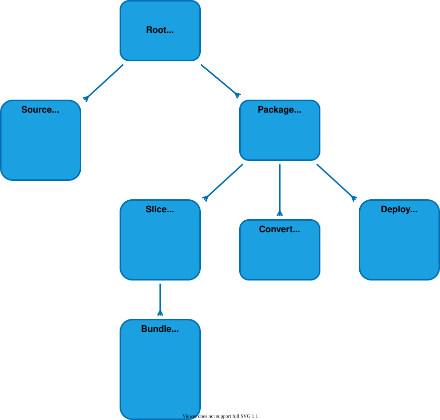

# $mol_build2

## Hierarhy



## Сборка и тесты

```
npx mam mol/build2/start
node mol/build2/start/-/node.js <модуль>
```

Тесты лежат рядом с модулями (`root`, `package/slice`, `bundle`) и прогоняются при сборке сборщика. Подопытные модули для них в `fixture`, пример приложения в `demo`.

## Устройство

- `start` — точка входа: CLI или дев-сервер. В корне `mol/build2` кода нет: иначе его тянули бы `fixture`, `demo` и `npm`.
- `server` — дев-сервер: `watch`, `slave`, `repl`, `client` для автоперезагрузки страницы.
- `root` — корень MAM и реестр плагинов, `root/ensure` — git и npm для исходников.
- `package` — собираемый пак, `package/slice` — его срезы по среде и стадии.
- `source`, `convert`, `bundle` — три рода плагинов: лоадеры, компайлеры, бандлеры. `bundle/checker` — тайпчекер в воркере.
- `npm` — реестр `$npm` для приложений.

## Плагины

Типы плагинов: лоадер (`$mol_build2_source`), компайлер (`$mol_build2_convert`), бандлер (`$mol_build2_bundle`). Плагин регистрируется при загрузке:

```typescript
namespace $ {

	export class $my_gql extends $mol_build2_convert {
		static match( file: $mol_file2 ) { return /\.gql$/.test( file.name() ) }
		generated_sources() { return [ /* .ts из схемы */ ] }
	}

	$mol_build2_root.plugin( $my_gql )

}
```

Пак подключает плагин файлом с тегом `.build.`:

```typescript
// my/app/app.build.ts
namespace $ {
	$my_gql
}
```

- `.build.`-файлы ищутся по всему графу пака, поэтому библиотека приносит свои плагины сама.
- Они и их зависимости собираются в `-/node.build.js` без модулей, которые уже есть в сборщике, и загружаются в его процесс до сборки пака. Родительские папки сюда не подтягиваются, поэтому плагин можно держать внутри приложения, например `app/plugin/x`: в сборщик попадёт только он и то, что он использует по FQN.
- Плагин видит только файлы в папке `.build.`-файла, который до него дотягивается по графу, и ниже. Плагин библиотеки обрабатывает её файлы, но не файлы приложения. Бандлер-плагин подключается, если в эту папку входит сам пак.
- Плагины видны только этому паку. В обычные бандлы `.build.`-файлы не попадают.
- Граф для поиска `.build.` строится встроенными лоадерами, плагин-лоадер объявляется на `.ts`.
- Два плагина на один файл роняют сборку.

Пример в `demo`: плагин `demo/plugin/md` превращает `text/intro.text.md` в константу `$mol_build2_demo_text_intro`. Тесты в `package/slice/slice_build.test.ts`.

## NPM

```typescript
const doc = $npm[ 'yaml' ].parse( text )
```

Сборщик сам ставит пакет, на вебе собирает его esbuild'ом в самодостаточный чанк
(tree-shaking по реально использованным членам), на ноде отдаёт рантайм-require.
Типы пакетов генерируются в `-web/deps.d.ts` / `-node/deps.d.ts` по факту использования.
Реестр `$npm` объявлен в `mol/build2/npm`, сборщик подключает его сам, как только в коде встречается `$npm`.

## ES-модули, CommonJS и FQN

```typescript
// esm/esm.ts
import { sum } from '../cjs/cjs.js'
export const greet = ( name: string )=> $.$my_hello( name ) + sum( 2, 3 )

// my.ts
namespace $ {
	export const $my_report = ()=> ( require( './esm/esm' ) as typeof import( './esm/esm' ) ).greet( 'FQN' )
}
```

Относительный `import`, `require` и `import()` дают зависимость на файл, расширение подбирается само (`.ts`, `.tsx`, `.js`, `index`). ES-модули транспилируются в CommonJS, а локальные CommonJS-модули регистрируются в `$node` под путём от корня (`/my/esm/esm`). Относительные пути в `require` и `import()` переписываются на этот ключ, поэтому FQN-код, ES-модули и CommonJS вызывают друг друга в одном бандле. Пример в `fixture/link`.
